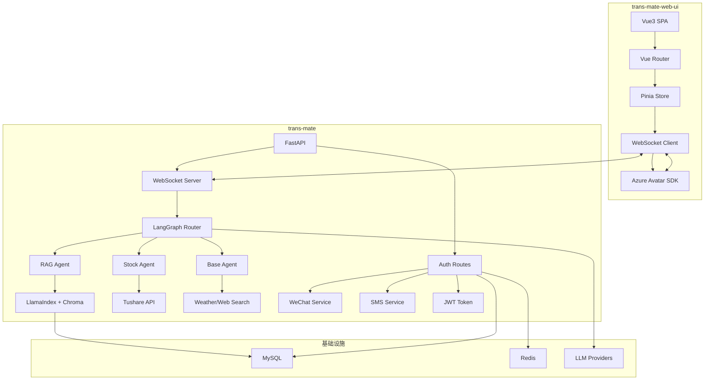

# Trans-Mate AI 智能助手 - 架构设计与技术文档

## 一、系统概述

Trans-Mate AI 智能助手是全栈自研的智能投顾系统，核心目标分为两类：
- **面向 C 端客户**：提供存款、理财、股票等投资建议
- **面向 B 端金融机构**：提供推流能力

系统采用前后端分离架构：
- **后端 (trans-mate)**：FastAPI + Python，提供 REST API 和 WebSocket 实时通信
- **前端 (trans-mate-web-ui)**：Vue3 + TypeScript，集成数字人Avatar交互

---

## 二、技术栈

### 2.1 前后端技术

| 层级 | 技术 | 说明 |
|------|------|------|
| 后端框架 | FastAPI | 高性能 Python Web 框架，支持异步和 WebSocket |
| 前端框架 | Vue 3 + TypeScript | 响应式 UI，类型安全 |
| 状态管理 | Pinia | Vue 3 官方推荐的状态管理方案 |
| UI 组件库 | Element Plus | 基于 Vue 3 的桌面端 UI 组件库 |
| 数据库 | MySQL + SQLAlchemy | ORM 关系型数据库 |
| 缓存 | Redis | 会话存储、验证码存储、限流 |
| 向量数据库 | Chroma | RAG 知识库向量存储 |
| LLM 框架 | LangChain / LangGraph | 智能体编排、流程控制 |
| 知识库检索 | LlamaIndex | RAG 向量检索 |
| 数字人 | Azure Avatar | AI Copilot 数字人语音合成 |

### 2.2 项目结构

```
trans-mate/                           # 后端项目
├── main.py                          # 应用入口 (FastAPI)
├── app/
│   ├── base/
│   │   └── auth_routes.py           # 认证路由 (微信/短信/密码登录)
│   ├── core/
│   │   ├── config.py                # 配置管理 (.env)
│   │   ├── database.py              # 数据库连接
│   │   └── redis.py                 # Redis 连接
│   ├── llm/
│   │   ├── agents/
│   │   │   ├── base_agent.py         # 通用智能体 (天气/搜索)
│   │   │   ├── stock_agent.py        # 股票数据智能体
│   │   │   └── rag_agent.py          # RAG 知识检索智能体
│   │   ├── models/
│   │   │   └── qwen_model.py         # LLM 模型池 (通义千问/Kimi)
│   │   ├── router.py                 # LangGraph 路由编排
│   │   ├── tools/                    # 工具函数
│   │   │   ├── weather_tool.py       # 天气查询
│   │   │   ├── web_tool.py           # 网页搜索
│   │   │   └── stock_tool.py         # 股票数据 (Tushare)
│   │   └── rag/
│   │       └── ingestion.py          # RAG 数据摄取
│   ├── models/
│   │   └── user.py                   # 用户模型
│   ├── schemas/
│   │   ├── auth.py                   # 认证 Schema
│   │   └── user.py                   # 用户 Schema
│   └── services/
│       ├── auth_service.py           # 认证服务
│       ├── sms_service.py            # 短信服务
│       ├── user_service.py           # 用户服务
│       └── wechat_service.py         # 微信服务
├── alembic/                          # 数据库迁移
├── store/                           # Chroma 向量存储
└── requirements.txt                 # Python 依赖

trans-mate-web-ui/                    # 前端项目
├── src/
│   ├── components/
│   │   ├── AppHeader.vue             # 顶部导航栏
│   │   ├── AppLeft.vue               # 左侧面板
│   │   ├── AppRight.vue              # 右侧面板
│   │   ├── ScrollSubtitle.vue        # 滚动字幕
│   │   ├── WeChatQRLogin.vue         # 微信二维码登录
│   │   ├── NicknameEditDialog.vue    # 昵称编辑弹窗
│   │   └── PasswordChangeDialog.vue  # 修改密码弹窗
│   ├── views/
│   │   ├── Home.vue                  # 首页 (对话 + 数字人)
│   │   ├── Login.vue                 # 登录页
│   │   ├── PersonalCenter.vue        # 个人中心
│   │   └── About.vue                 # 关于页
│   ├── services/
│   │   ├── api.ts                    # API 请求服务
│   │   └── azure-sdk.ts              # Azure 数字人 SDK
│   ├── stores/
│   │   └── user.ts                   # 用户状态 (Pinia)
│   ├── router/
│   │   └── index.ts                  # 路由配置 + 守卫
│   ├── config/
│   │   └── app-config.ts             # 应用配置
│   ├── types/
│   │   └── index.ts                  # TypeScript 类型定义
│   └── utils/
│       └── time-utils.ts              # 时间工具函数
├── package.json
└── vite.config.ts
```

---

## 三、核心架构

### 3.1 整体架构图



### 3.2 LLM 路由策略 (LangGraph)

系统采用 **RAG 优先** 策略，通过 LangGraph 实现智能路由：

```python
# router.py - 核心路由逻辑
def create_agent_graph():
    workflow = StateGraph(AgentState)
    
    # 节点定义
    workflow.add_node("rag_retrieval", try_rag_retrieval)      # RAG 检索
    workflow.add_node("rag_agent", call_rag_agent)             # RAG 返回结果
    workflow.add_node("classifier", classify_intent)           # 意图分类
    workflow.add_node("base_agent", call_base_agent)           # 通用智能体
    workflow.add_node("stock_agent", call_stock_agent)         # 股票智能体
    
    # 流程编排
    workflow.set_entry_point("rag_retrieval")
    
    workflow.add_conditional_edges(
        "rag_retrieval",
        lambda x: "rag" if x.get("rag_available", False) else "fallback",
        {"rag": "rag_agent", "fallback": "classifier"},
    )
    
    workflow.add_conditional_edges(
        "classifier",
        lambda x: x.get("intent", "general"),
        {"stock": "stock_agent", "general": "base_agent"},
    )
    
    return workflow.compile()
```

**路由决策流程：**
1. **RAG 检索**：优先从知识库检索，若命中则直接返回
2. **意图分类**：若 RAG 未命中，判断用户意图是"股票"还是"通用"
3. **智能体分发**：
   - 股票相关 → `stock_agent` (调用 Tushare 获取行情)
   - 通用问题 → `base_agent` (调用天气/搜索工具)

---

## 四、智能体设计

### 4.1 Agent 概览

| 智能体 | 角色 | 工具 | 用途 |
|--------|------|------|------|
| base_agent | 通用智能助手 | get_weather, web_search | 天气查询、网络搜索 |
| stock_agent | 股票数据专家 | get_stock_info, get_stock_daily, get_stock_realtime, get_index_daily, get_stock_daily_basic, search_stock | 股票数据查询 (Tushare) |
| rag_agent | 知识库检索 | LlamaIndex Retriever | RAG 知识问答 |

### 4.2 股票工具函数

```python
# stock_tool.py - 股票数据工具
from app.llm.tools.stock_tool import (
    get_stock_info,        # 获取股票基本信息
    get_stock_daily,      # 获取股票日线数据
    get_stock_realtime,   # 获取股票实时行情
    get_index_daily,      # 获取指数日线数据
    get_stock_daily_basic,# 获取股票每日基本面指标
    search_stock,          # 搜索股票
)
```

### 4.3 RAG 知识库

```python
# rag_agent.py - RAG 检索实现
class RAGAgent:
    def retrieve(self, query: str) -> Tuple[bool, str]:
        # 1. 向量检索 (Chroma + LlamaIndex)
        nodes = retriever.retrieve(query)
        
        # 2. 相似度过滤 (threshold: 0.5)
        relevant_nodes = [n for n in nodes if n.score >= threshold]
        
        # 3. LLM 生成回答
        response = self._generate_response(query, context)
        return True, response
```

---

## 五、用户认证系统

### 5.1 认证场景

#### 场景一：微信授权登录

**流程：**
1. 前端调用微信授权，获取 code
2. 后端用 code 换取 openid/unionid
3. 查询数据库：存在则登录，不存在则自动注册
4. 生成 JWT Token 返回

#### 场景二：手机号 + 验证码登录

**流程：**
1. 前端请求 `/send-code?phone=138...`
2. 后端生成 6 位验证码，存入 Redis (60s 过期)
3. 调用短信服务商 API 发送验证码
4. 前端提交 `phone + code` 验证登录

#### 场景三：密码登录

- 支持首次密码登录（自动注册）
- 修改密码后强制所有设备下线

### 5.2 用户表设计

**trans_user 表结构：**

| 字段 | 类型 | 说明 |
|------|------|------|
| id | BigInteger | 自增主键 |
| username | String | 用户名（唯一） |
| email | String | 邮箱（唯一，可空） |
| password_hash | String | 密码哈希（可空） |
| is_password_set | Boolean | 是否已设置密码 |
| nickname | String | 昵称 |
| avatar_url | String | 头像 URL |
| phone | String | 手机号（唯一，可空） |
| wechat_openid | String | 微信 openid（唯一，可空） |
| wechat_unionid | String | 微信 unionid（可空） |
| register_source | String | 注册来源：WECHAT, SMS, PASSWORD |
| created_at | DateTime | 创建时间 |
| updated_at | DateTime | 更新时间 |

---

## 六、Token 与 Session 管理

### 6.1 双 Token 机制

| Token 类型 | 有效期 | 用途 |
|------------|--------|------|
| Access Token | 30 分钟 - 2 小时 | 业务接口鉴权 |
| Refresh Token | 7 天 - 30 天 | 换取新的 Access Token |

### 6.2 Redis 存储

| Key 格式 | 说明 |
|----------|------|
| `auth:session:{user_id}:{device_id}` | 登录 Session 状态 |
| `auth:refresh:{user_id}:{device_id}` | Refresh Token 哈希值 |
| `auth:blacklist:{jti}` | Token 黑名单 |
| `code:login:{phone}` | 短信验证码 |

---

## 七、前端特性

### 7.1 页面路由

| 路径 | 组件 | 权限 |
|------|------|------|
| `/` | Home | 需要登录 |
| `/login` | Login | 游客专用 |
| `/about` | About | 公开 |
| `/personal-center` | PersonalCenter | 需要登录 |

### 7.2 核心功能

- **WebSocket 实时通信**：与后端 AI 智能体对话
- **Azure Avatar 数字人**：
  - 语音合成 (Text-to-Speech)
  - 数字人视频流 (WebRTC)
  - 字幕同步显示
- **语音录制**：麦克风输入，WebSocket 传输
- **视频通话**：WebRTC 实时视频流

### 7.3 状态管理

```typescript
// stores/user.ts - Pinia Store
const useUserStore = defineStore('user', {
  state: () => ({
    userInfo: null as UserInfo | null,
    token: '',
    isLoggedIn: false,
  }),
  actions: {
    async login(credentials) { /* ... */ },
    async logoutUser() { /* ... */ },
    async fetchUserInfo() { /* ... */ },
  },
})
```

---

## 八、配置管理

### 8.1 后端配置 (.env)

```bash
# Database
DB_HOST=localhost
DB_PORT=3306
DB_USER=root
DB_PASSWORD=***
DB_NAME=trans_mate

# Redis
REDIS_HOST=localhost
REDIS_PORT=6379

# LLM
DEFAULT_API_KEY=***
DEFAULT_MODEL=qwen-plus
KIMI_API_KEY=***

# WeChat
WECHAT_APPID=***
WECHAT_SECRET=***

# SMS
SMS_ACCESS_KEY=***
SMS_TEMPLATE_CODE=***

# RAG
EMBEDDING_MODEL=BAAI/bge-small-zh-v1.5
RAG_TOP_K=3
```

### 8.2 前端配置

```typescript
// config/app-config.ts
export const appConfig = {
  azureRegion: import.meta.env.VITE_AZURE_REGION,
  azureSubscriptionKey: import.meta.env.VITE_AZURE_SUBSCRIPTION_KEY,
  wsEndpoint: import.meta.env.VITE_WS_ENDPOINT || '',
}
```

---

## 九、部署

### 9.1 后端部署

```bash
# 安装依赖
pip install -r requirements.txt

# 数据库迁移
alembic upgrade head

# 启动服务
uvicorn main:app --host 0.0.0.0 --port 8000 --reload
```

### 9.2 前端部署

```bash
# 安装依赖
npm install

# 开发模式
npm run dev

# 构建生产
npm run build
```

### 9.3 Docker 支持

项目已提供 Dockerfile，可容器化部署：

```bash
docker build -t trans-mate:latest -f trans-mate/docker/Dockerfile .
```

---

## 十、总结

Trans-Mate AI 智能助手架构的核心亮点：

1. **RAG 优先路由**：LangGraph 实现智能分流，知识库检索优先，提升响应准确率
2. **专业智能体分工**：base_agent (通用)、stock_agent (股票)、rag_agent (知识库)，各司其职
3. **实时交互**：WebSocket + Azure Avatar 实现数字人语音对话
4. **多端认证**：微信、短信、密码三种登录方式，支持首次登录自动注册
5. **完善会话管理**：双 Token + Redis，支持多设备管理和主动失效
6. **向量知识库**：LlamaIndex + Chroma 支持金融产品知识 RAG 检索
