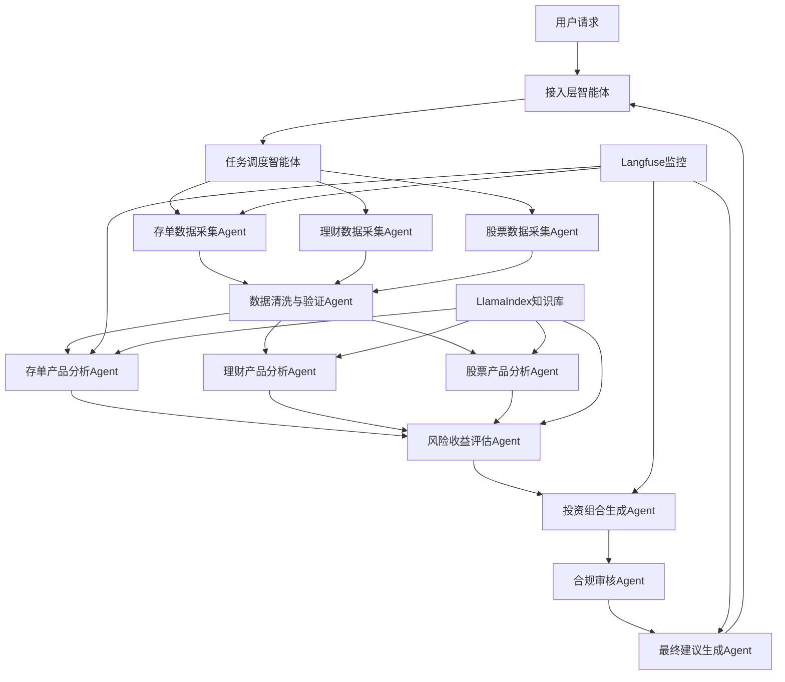

# Trans-Mate AI 智能助手 - 架构设计与技术文档

## 一、系统概述

Trans-Mate AI 智能助手是全栈自研的智能投顾系统，核心目标分为两类：
- **面向 C 端客户**：提供存款、理财、股票等投资建议
- **面向 B 端金融机构**：提供推流能力

---

## 二、核心技术栈

### 2.1 前后端技术

| 层级 | 技术 | 选型原因 |
|------|------|----------|
| 前端 | Vue3 + TypeScript | 保障类型安全与开发效率 |
| 后端 | FastAPI + Python | 高性能、易扩展，适配金融场景接口需求 |

### 2.2 核心技术组件及分工



#### 技术选型对比表

| 架构层 | 核心工具 | 选型原因 |
|--------|----------|----------|
| 多智能体协作 | CrewAI + AutoGen | CrewAI 负责角色化流程管控，AutoGen 专注代码执行与数据计算 |
| 流程编排 | LangGraph | 处理 "数据采集→分析→审核→建议" 全流程，支持循环/分支逻辑 |
| 数据检索 | LlamaIndex | 管理金融产品知识库，支撑 RAG 技术实现精准投资分析 |
| 基础组件 | LangChain | 封装 LLM 调用、工具调用（金融数据 API）、Prompt 模板 |
| 可观测性 | Langfuse | 监控各智能体调用链路、分析结果质量、LLM 成本/响应时间 |

---

## 三、各模块智能体设计与功能拆解

### 3.1 核心智能体角色定义（CrewAI 实现）

每个智能体有明确的**角色、目标、技能**，通过 CrewAI 的 `Agent` 类定义，支持顺序/并行执行任务。

```python
from crewai import Agent, Task, Crew, Process
from langchain_openai import ChatOpenAI
import os

# 初始化 LLM（建议用金融微调模型，如 GPT-4o/通义千问金融版）
llm = ChatOpenAI(
    model="gpt-4o",
    api_key=os.getenv("OPENAI_API_KEY"),
    temperature=0.1  # 金融场景低随机性，保证准确性
)

# 1. 数据采集智能体（按产品类型拆分）
deposit_data_agent = Agent(
    role="存单数据采集专家",
    goal="采集银行存单产品的利率、期限、起购金额、发行银行等数据",
    backstory="精通银行数据接口，能快速采集各银行存单产品信息",
    tools=[bank_api_tool],
    llm=llm,
    verbose=True
)

wealth_data_agent = Agent(
    role="理财产品数据采集专家",
    goal="采集银行理财产品的收益率、风险等级、投资方向、历史业绩等数据",
    backstory="熟悉理财产品数据库，能处理净值型/预期收益型产品数据",
    tools=[wealth_api_tool],
    llm=llm,
    verbose=True
)

stock_data_agent = Agent(
    role="股票产品数据采集专家",
    goal="采集个股/指数/基金的行情、财务指标、估值、行业分类等数据",
    backstory="精通股票数据接口（如 Tushare/同花顺），能处理实时/历史行情数据",
    tools=[stock_api_tool],
    llm=llm,
    verbose=True
)

# 2. 数据清洗验证智能体
data_clean_agent = Agent(
    role="金融数据清洗专家",
    goal="验证采集数据的完整性、准确性，统一数据格式，剔除异常值",
    backstory="熟悉金融数据校验规则，能识别数据缺失/错误，保证分析基础可靠",
    tools=[data_validate_tool],
    llm=llm,
    verbose=True
)

# 3. 产品分析智能体
deposit_analysis_agent = Agent(
    role="存单产品分析专家",
    goal="分析存单产品的收益对比、流动性、适用人群，生成标准化分析报告",
    backstory="10 年银行理财经验，擅长存单产品横向/纵向对比",
    tools=[llama_index_retriever],  # 调用 LlamaIndex 知识库（历史存单数据）
    llm=llm,
    verbose=True
)

wealth_analysis_agent = Agent(
    role="理财产品分析专家",
    goal="分析理财产品的风险收益特征、底层资产安全性、业绩基准达成率",
    backstory="CFA 持证人，专注理财产品风控与收益分析",
    tools=[llama_index_retriever],
    llm=llm,
    verbose=True
)

stock_analysis_agent = Agent(
    role="股票产品分析专家",
    goal="分析股票/基金的估值水平、行业趋势、风险点，给出基本面判断",
    backstory="资深投顾，擅长技术面+基本面分析，熟悉行业轮动规律",
    tools=[llama_index_retriever, code_execution_tool],  # 代码执行工具用于量化计算
    llm=llm,
    verbose=True
)

# 4. 风险收益评估智能体
risk_assess_agent = Agent(
    role="风险收益评估专家",
    goal="综合评估存单/理财/股票产品的风险等级、收益稳定性、适配场景",
    backstory="FRM 持证人，专注资产配置与风险评估",
    llm=llm,
    verbose=True
)

# 5. 投资组合生成智能体
portfolio_agent = Agent(
    role="投资组合生成专家",
    goal="根据用户风险偏好和三类产品的评估结果，生成最优配置方案",
    backstory="具备资产配置优化算法能力，能平衡收益与风险",
    llm=llm,
    verbose=True
)

# 6. 合规审核智能体
compliance_agent = Agent(
    role="合规审核专家",
    goal="审核投资建议是否符合金融监管要求，剔除违规表述",
    backstory="熟悉金融监管政策，能识别虚假宣传、承诺收益等违规行为",
    llm=llm,
    verbose=True
)
```

### 3.2 流程编排（LangGraph 实现）

通过 LangGraph 定义 "数据采集→清洗→分析→评估→组合→合规审核→生成建议" 的流程：

```python
from langgraph.graph import StateGraph, END
from typing import TypedDict, List
import json

# 定义全局状态（传递各智能体的输出）
class InvestmentState(TypedDict):
    user_query: str  # 用户输入（如"30万资金，风险偏好稳健，推荐存单+理财+股票组合"）
    user_risk: str   # 用户风险偏好（保守/稳健/进取）
    deposit_data: dict  # 存单采集数据
    wealth_data: dict   # 理财采集数据
    stock_data: dict    # 股票采集数据
    cleaned_data: dict  # 清洗后数据
    deposit_analysis: str  # 存单分析结果
    wealth_analysis: str   # 理财分析结果
    stock_analysis: str    # 股票分析结果
    risk_assessment: str   # 风险收益评估
    portfolio: str         # 投资组合建议
    compliance_check: bool # 合规审核结果
    final_suggestion: str  # 最终投顾建议

# 定义各节点函数（调用 CrewAI 的智能体执行任务）
def collect_data_node(state: InvestmentState):
    """数据采集节点：并行采集存单/理财/股票数据"""
    deposit_data = deposit_data_agent.execute_task(
        Task(description="采集当前主流银行存单产品的利率、期限、起购金额数据")
    )
    wealth_data = wealth_data_agent.execute_task(
        Task(description="采集当前在售理财产品的收益率、风险等级、投资方向数据")
    )
    stock_data = stock_data_agent.execute_task(
        Task(description="采集近期表现稳定的股票/基金数据，包含行情、估值、行业分类")
    )
    return {
        "deposit_data": deposit_data,
        "wealth_data": wealth_data,
        "stock_data": stock_data
    }

def clean_data_node(state: InvestmentState):
    """数据清洗节点"""
    cleaned_data = data_clean_agent.execute_task(
        Task(description=f"清洗以下数据，确保格式统一、无异常值：{json.dumps([state['deposit_data'], state['wealth_data'], state['stock_data']])}")
    )
    return {"cleaned_data": cleaned_data}

def analyze_products_node(state: InvestmentState):
    """产品分析节点：并行分析三类产品"""
    deposit_analysis = deposit_analysis_agent.execute_task(
        Task(description=f"分析清洗后的存单数据：{state['cleaned_data']['deposit']}，对比收益/流动性")
    )
    wealth_analysis = wealth_analysis_agent.execute_task(
        Task(description=f"分析清洗后的理财数据：{state['cleaned_data']['wealth']}，评估风险/收益")
    )
    stock_analysis = stock_analysis_agent.execute_task(
        Task(description=f"分析清洗后的股票数据：{state['cleaned_data']['stock']}，评估估值/趋势")
    )
    return {
        "deposit_analysis": deposit_analysis,
        "wealth_analysis": wealth_analysis,
        "stock_analysis": stock_analysis
    }

def risk_assess_node(state: InvestmentState):
    """风险收益评估节点"""
    risk_assessment = risk_assess_agent.execute_task(
        Task(description=f"基于以下分析结果，评估三类产品的风险收益适配性（用户风险偏好：{state['user_risk']}）：{json.dumps([state['deposit_analysis'], state['wealth_analysis'], state['stock_analysis']])}")
    )
    return {"risk_assessment": risk_assessment}

def generate_portfolio_node(state: InvestmentState):
    """投资组合生成节点"""
    portfolio = portfolio_agent.execute_task(
        Task(description=f"根据风险评估结果{state['risk_assessment']}，为{state['user_risk']}型用户生成存单/理财/股票的配置比例")
    )
    return {"portfolio": portfolio}

def compliance_check_node(state: InvestmentState):
    """合规审核节点"""
    compliance_result = compliance_agent.execute_task(
        Task(description=f"审核投资组合建议：{state['portfolio']}，检查是否有违规表述，返回 True（合规）或 False（不合规）")
    )
    return {"compliance_check": "合规" in compliance_result}

def generate_suggestion_node(state: InvestmentState):
    """生成最终建议节点"""
    final_suggestion = portfolio_agent.execute_task(
        Task(description=f"将合规的投资组合{state['portfolio']}转化为通俗易懂的投顾建议，适配普通用户理解")
    )
    return {"final_suggestion": final_suggestion}

# 构建 LangGraph 流程
workflow = StateGraph(InvestmentState)

# 添加节点
workflow.add_node("collect_data", collect_data_node)
workflow.add_node("clean_data", clean_data_node)
workflow.add_node("analyze_products", analyze_products_node)
workflow.add_node("risk_assess", risk_assess_node)
workflow.add_node("generate_portfolio", generate_portfolio_node)
workflow.add_node("compliance_check", compliance_check_node)
workflow.add_node("generate_suggestion", generate_suggestion_node)

# 设置流程顺序
workflow.set_entry_point("collect_data")
workflow.add_edge("collect_data", "clean_data")
workflow.add_edge("clean_data", "analyze_products")
workflow.add_edge("analyze_products", "risk_assess")
workflow.add_edge("risk_assess", "generate_portfolio")
workflow.add_edge("generate_portfolio", "compliance_check")

# 合规分支：不合规时重新生成组合
def compliance_branch(state: InvestmentState):
    return "generate_suggestion" if state["compliance_check"] else "generate_portfolio"

workflow.add_conditional_edges("compliance_check", compliance_branch)
workflow.add_edge("generate_suggestion", END)

# 编译流程
app = workflow.compile()

# 调用示例
user_input = {
    "user_query": "30万资金，风险偏好稳健，推荐存单+理财+股票的组合",
    "user_risk": "稳健"
}
result = app.invoke(user_input)
print("最终投顾建议：", result["final_suggestion"])
```

### 3.3 关键工具与组件实现

#### 3.3.1 LlamaIndex 金融知识库（RAG）

用于存储金融产品历史数据、监管规则、分析模型等，支撑分析智能体的精准判断：

```python
from llama_index.core import SimpleDirectoryReader, VectorStoreIndex, StorageContext
from llama_index.core.retrievers import VectorIndexRetriever
from llama_index.core.query_engine import RetrieverQueryEngine

# 加载金融知识库（存单规则、理财监管文件、股票分析模型等）
documents = SimpleDirectoryReader("financial_knowledge_base").load_data()

# 构建向量索引
index = VectorStoreIndex.from_documents(documents)

# 封装为工具（供分析智能体调用）
llama_index_retriever = index.as_retriever()
```

#### 3.3.2 Langfuse 监控集成

监控各智能体的调用链路、LLM 响应时间、分析结果质量：

```python
from langfuse.callback import CallbackHandler
from langfuse import Langfuse

# 初始化 Langfuse 回调
langfuse_handler = CallbackHandler(
    secret_key=os.getenv("LANGFUSE_SECRET_KEY"),
    public_key=os.getenv("LANGFUSE_PUBLIC_KEY"),
    host="https://cloud.langfuse.com"
)
langfuse = Langfuse(
    secret_key=os.getenv("LANGFUSE_SECRET_KEY"),
    public_key=os.getenv("LANGFUSE_PUBLIC_KEY"),
    host="https://cloud.langfuse.com"
)

# 将回调添加到 LLM（所有智能体的 LLM 调用都会被追踪）
llm = ChatOpenAI(
    model="gpt-4o",
    api_key=os.getenv("OPENAI_API_KEY"),
    temperature=0.1,
    callbacks=[langfuse_handler]
)

# 自定义评估（比如评估投资建议的合理性）
def evaluate_suggestion(suggestion: str, user_risk: str):
    eval_prompt = f"评估以下投顾建议是否适配{user_risk}型用户：{suggestion}，评分 1-5 分，理由简述"
    eval_result = llm.invoke(eval_prompt)
    
    # 记录评估到 Langfuse
    langfuse.score(
        name="suggestion_risk_match",
        value=int(eval_result.content.split()[0]),  # 提取评分
        comment=" ".join(eval_result.content.split()[1:])
    )
```

#### 3.3.3 AutoGen 代码执行工具（量化计算）

用于股票分析智能体执行量化计算（如市盈率、夏普比率等）：

```python
from autogen import AssistantAgent, UserProxyAgent

# 初始化代码执行智能体
code_exec_agent = AssistantAgent(
    name="code_executor",
    llm_config={"config_list": [{"model": "gpt-4o", "api_key": os.getenv("OPENAI_API_KEY")}]}
)
user_proxy = UserProxyAgent(
    name="user_proxy",
    human_input_mode="NEVER",
    code_execution_config={"work_dir": "financial_calc", "use_docker": False}
)

# 封装为工具（供股票分析智能体调用）
def code_execution_tool(code: str) -> str:
    """执行金融量化计算代码"""
    chat_result = user_proxy.initiate_chat(
        code_exec_agent,
        message=f"执行以下金融计算代码，返回结果：{code}"
    )
    return chat_result.summary
```

---

## 四、核心特性与落地注意事项

### 4.1 核心特性

1. **分工协作**：不同产品类型由专门智能体处理，通过 LangGraph 编排流程，支持合规审核失败时重新生成建议
2. **RAG 增强**：LlamaIndex 管理金融知识库，分析智能体能基于历史数据和监管规则做更精准判断
3. **可观测性**：Langfuse 追踪全流程，便于监控各节点耗时和分析结果质量
4. **量化计算**：AutoGen 支持代码执行，股票分析可调用 Python 进行技术指标计算

### 4.2 落地注意事项

- **数据合规**：采集金融数据需获得授权（接入正规金融数据服务商），避免侵权
- **风险提示**：最终建议必须包含"投资有风险，入市需谨慎"等合规表述，合规审核智能体需严格校验
- **模型选择**：优先使用金融微调的 LLM（如通义千问金融版、百度文心一言金融版），提升分析准确性
- **性能优化**：对采集的金融数据做缓存（如 Redis），避免重复调用 API
- **人工介入**：高风险用户（如进取型）的建议需支持人工复核，可在 LangGraph 中添加"人工审核节点"

---

## 五、用户认证系统

### 5.1 认证场景设计

#### 场景一：微信授权登录（一键注册/登录）

**流程：**
1. 前端调用微信授权，获取 code
2. 后端用 code 换取 openid/unionid（请求微信接口）
3. 查询数据库：
   - 若 openid 存在 → 登录成功，生成 Token 返回
   - 若不存在 → 自动注册新用户（无密码），生成 Token 返回
4. **关键**：此时通常无法直接获取用户手机号（除非使用微信手机号快速填充组件）
   - 前端在微信授权后，额外调用微信"获取手机号"接口，将解密后的手机号传给后端
   - 插入数据库：`password_hash` 为空，`is_password_set = 0`
   - 生成 Token 返回

**修改密码功能：**
由于初始密码为空，用户需在"个人中心"点击"设置密码"：
- 校验当前登录态 → 输入新密码 → 更新 `password_hash` 和 `is_password_set = 1`

#### 场景二：手机号 + 验证码登录 (Redis 60s 失效)

**特点**：无密码，依赖短信网关和 Redis

**发送验证码流程：**
1. 前端请求 `/send-code?phone=138...`
2. 后端生成 6 位随机码
3. Redis 操作：`SETEX code:login:138xxxx 60 <验证码>` (60 秒过期)
4. 调用短信服务商 API 发送

**登录验证流程：**
1. 前端提交 `phone + code`
2. 后端从 Redis 获取：`val = GET code:login:138xxxx`
3. 校验：
   - 若 `val` 为空：提示"验证码过期或不存在"
   - 若 `val != code`：提示"验证码错误"
   - 若匹配成功：登录成功，生成 Token

### 5.2 首次密码登录逻辑

**场景**：用户之前是通过微信或短信注册的，从未设过密码

**策略**：
- 此时输入的 password 应被视为"首次设置密码"
- 执行更新：`UPDATE users SET password_hash = ?, is_password_set = 1 WHERE id = ?`
- 返回 Token (登录成功)
- 前端可在此时弹窗提示"检测到您首次使用密码登录，已为您自动设置密码"

### 5.3 用户表设计

**trans_user 表结构：**

| 字段 | 类型 | 说明 |
|------|------|------|
| id | BigInteger | 自增主键 |
| username | String | 用户名（唯一） |
| email | String | 邮箱（唯一，可空） |
| password_hash | String | 密码哈希（可空） |
| is_password_set | Boolean | 是否已设置密码 |
| nickname | String | 昵称 |
| avatar_url | String | 头像 URL |
| phone | String | 手机号（唯一，可空 - 微信登录可为空） |
| wechat_openid | String | 微信 openid（唯一，可空） |
| wechat_unionid | String | 微信 unionid（可空） |
| register_source | String | 注册来源：WECHAT, SMS, PASSWORD |
| created_at | DateTime | 创建时间 |
| updated_at | DateTime | 更新时间 |

---

## 六、Token 与 Session 管理

### 6.1 核心设计原则

**双 Token 机制 (Access + Refresh)**

| Token 类型 | 有效期 | 用途 | 存储要求 |
|------------|--------|------|----------|
| Access Token | 短效（30 分钟 - 2 小时） | 用于业务接口鉴权 | 泄露风险低，因为很快过期 |
| Refresh Token | 长效（7 天 - 30 天） | 仅用于换取新的 Access Token | 必须存入 Redis 进行严格管理 |

**最小权限与信息脱敏**
- JWT Payload 中严禁存放敏感信息（如明文密码、完整身份证号）
- 只存必要字段：`user_id`, `username`, `role`, `device_id` (用于区分设备)

**唯一性与设备隔离**
- 同一个用户在手机、PC、平板登录，应生成不同的 Token
- Redis Key 设计需体现 `user_id + device_id`，以支持"多端在线"或"单端互踢"策略

### 6.2 Redis 存储规则设计

#### Key 命名规范 (Naming Convention)

采用分层结构，便于管理和批量操作。

**格式**：`业务前缀:模块:唯一标识:子标识`

| 类型 | Key 示例 | 说明 |
|------|----------|------|
| Session | `auth:session:{user_id}:{device_id}` | 存储用户的登录 Session 状态 |
| Refresh Token | `auth:refresh:{user_id}:{device_id}` | 存储 Refresh Token 哈希值 |
| Blacklist | `auth:blacklist:{jti}` | 被强制失效的 Token JTI |
| Rate Limit | `ratelimit:api:{user_id}:{endpoint}` | API 限流计数器 |

#### 过期策略 (TTL)

- **绝对过期**：设置固定的 TTL（如 7 天）
- **业务触发过期**：
  - 用户主动登出
  - 修改密码（强制所有设备下线）
  - 账号封禁

### 6.3 详细交互流程

#### 登录成功（签发 Token）

假设用户登录成功，生成了 `access_token` (2h) 和 `refresh_token` (7d)，设备 ID 为 `dev_001`。

```
生成 Token：后端使用私钥签名生成 JWT
    ↓
写入 Redis：
    auth:session:{user_id}:dev_001  ->  { "refresh_jti": "xxx", "access_jti": "yyy" }  (TTL: 7天)
    auth:refresh:{user_id}:dev_001  ->  <refresh_token_hash>  (TTL: 7天)
    ↓
返回前端：
    { "access_token": "...", "refresh_token": "...", "expires_in": 7200 }
```

#### 业务请求鉴权

1. 前端 Header 携带 `Authorization: Bearer <access_token>`
2. 网关/拦截器解析 JWT：
   - 验证签名是否合法
   - 验证是否过期 (exp)
3. 二次校验（关键步骤）：
   - 如果业务需要强制下线功能（如改密、封号）：
     - 检查 Redis 中 `auth:session:{user_id}:{device_id}` 是否存在
     - 或者检查 JWT 中的 jti 是否在 Redis 黑名单 `auth:blacklist:{jti}` 中
   - 如果 Redis 中无记录或在黑名单中 → 拒绝访问 (401)

#### Token 刷新 (Refresh Flow)

当 Access Token 过期，前端携带 Refresh Token 请求 `/auth/refresh`：

```
后端从 Redis 获取：auth:refresh:{user_id}:{device_id}
    ↓
比对：Redis 中的值 vs 请求中的 Refresh Token
    ↓
匹配 → 生成新的 Access Token (和可选的新 Refresh Token)
    ↓
更新 Redis：auth:session:{user_id}:{device_id} 中的 access_jti
    ↓
返回新的 Access Token
```

#### 主动失效 Token（登出、改密、封号）

**场景 1：用户主动登出**
```
删除 Redis 中的 Session：DEL auth:session:{user_id}:dev_001
可选：将 Access Token 的 jti 加入黑名单（短 TTL = access_token 剩余有效期）
```

**场景 2：修改密码（强制所有设备下线）**
```
方案 A（推荐）：
    增加用户 Token 版本号（user.token_version）
    修改密码时：UPDATE users SET token_version = token_version + 1 WHERE id = {user_id}
    JWT 中需包含 token_version 字段
    每次鉴权时比对 JWT.token_version vs DB.token_version
    不一致则失效（此方案无需遍历 Redis 删除，性能更好，但无法精确到设备）
```

### 6.4 微信/短信首次登录 (自动注册)

逻辑同普通登录。

**注意**：如果是新用户，Redis 中原本没有该 user_id 的 Key，直接新建即可。

---

## 七、总结

Trans-Mate AI 智能助手架构的核心亮点：

1. **分层多智能体**：按"数据→分析→决策→合规"分工，兼顾专业性和协作效率，CrewAI 负责角色化分工，LangGraph 负责流程编排
2. **技术栈适配**：LlamaIndex 解决金融知识库检索，Langfuse 保障可观测性，AutoGen 支撑量化计算
3. **合规优先**：内置合规审核智能体，符合金融投顾业务的监管要求
4. **完善的认证体系**：支持微信、短信、密码多种登录方式，双 Token 机制保障安全
5. **可靠的会话管理**：Redis 存储 Refresh Token，支持主动失效和多设备管理
